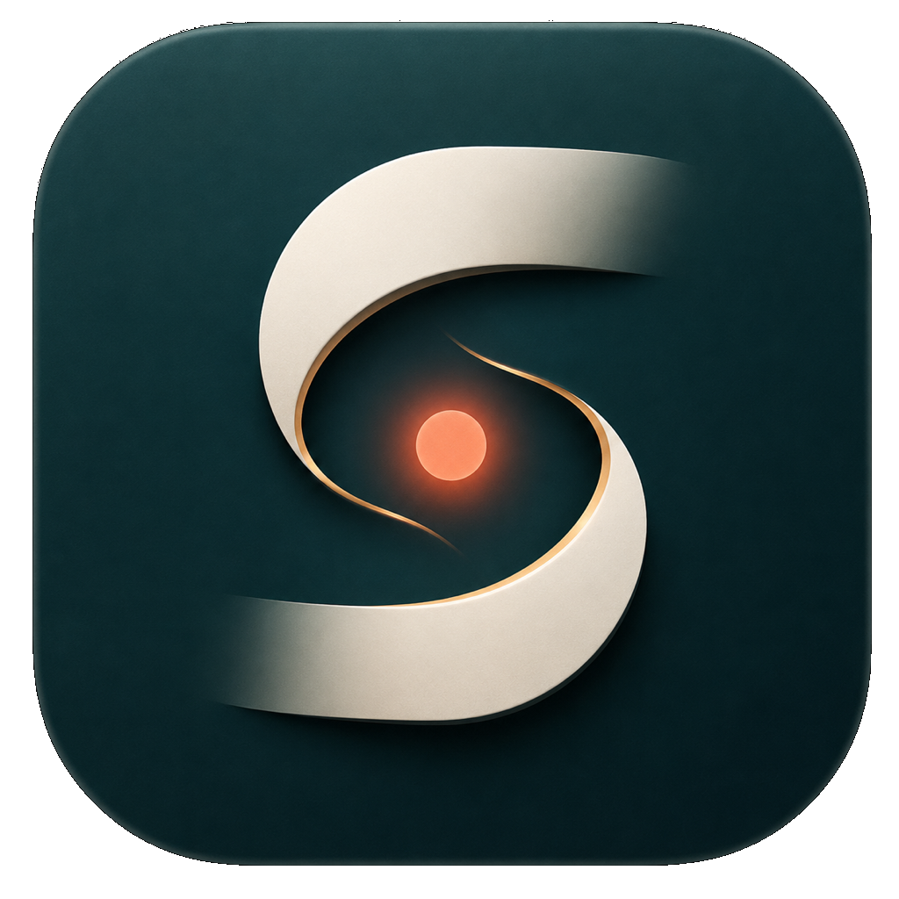

# Salient



Salient is a macOS reader that reads text aloud on your Mac. It runs speech
locally with a bundled Pocket TTS voice. You can also use Apple system voices,
or an optional Qwen voice runtime that you install yourself. It includes RSVP
(one word at a time) reading and guarded keyboard shortcuts for the front tab
in Safari or Chrome.

> **Status: source preview.** No notarized, downloadable release has been
> published on GitHub yet. To try Salient, build it from source. Signed
> distribution is being prepared separately.

## Features

- **Local speech by default.** Salient bundles Kyutai Pocket TTS 4.0.1 with its
  English stock model and the Alba voice. A packaged app reads aloud offline,
  even on first launch.
- **Other voices.** You can use Apple system voices, or the optional Qwen voice
  runtime. Qwen is installed only when you choose it.
- **RSVP reading** with read-along timing.
- **Browser shortcuts** for the front Safari or Chrome tab. They require browser permission
  and act when you use a button or shortcut.
- **Reader only.** The reader app has no study library.

## App identity

This repository contains only **Salient**, the reader. Its internal SwiftPM
product remains `SalientMini` and its bundle ID remains
`com.zhuou.salient.mini`, so existing installations keep their saved preferences.

## Quick start

You need an Apple Silicon Mac, Xcode 27 (Swift 6.4) with the Metal toolchain,
Rust, and CMake. The app targets macOS 14 or later; older-OS device testing is still pending.

```sh
git clone https://github.com/o-zhu/salient.git
cd salient
./script/build_and_run.sh          # build dist/Salient.app and open it
```

- `./script/build_and_run.sh build` builds `dist/Salient.app` without opening it.
- `./script/build_and_run.sh package` makes an optimized build.

The first build downloads about 226 MB of pinned, checksum-verified public
model files into `.build/`. These files are never committed to Git.
For details, see [docs/building.md](docs/building.md).

## Documentation

- [Building and testing](docs/building.md)
- [Architecture](docs/architecture.md)
- [Privacy](docs/privacy.md)
- [Releasing](docs/releasing.md)
- [Initial verification](docs/verification.md)
- [Contributing](CONTRIBUTING.md) · [Security](SECURITY.md) · [Third-party notices](THIRD_PARTY.md)

## License

Salient's source code is released under the [MIT License](LICENSE). Bundled
and downloaded models, voices, and third-party code keep their own licenses.
See [THIRD_PARTY.md](THIRD_PARTY.md).
